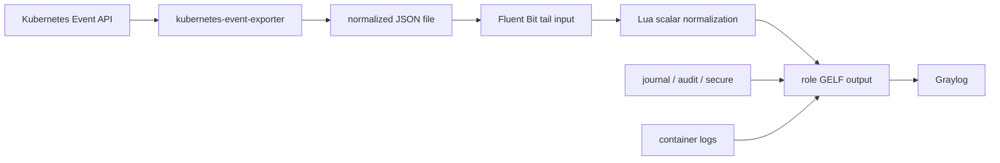

# Ansible Role: `tuxbull.journal_forwarder`

Linux-only Ansible role for forwarding systemd journal, audit, and selected security/application logs to **Graylog** with **Fluent Bit** over GELF.

**Next release: `v1.1.2`**

> Windows Event Log forwarding is handled by Ansible role [`joe-speedboat.winlogbeat_forwarder`](https://github.com/joe-speedboat/ansible.winlogbeat_forwarder) with Winlogbeat OSS.   
This role owns the Linux/Fluent Bit side only.

## Requirements

### Control Node

- Ansible >= 2.14
- SSH access to Linux targets with root / privilege escalation

### Target Nodes

- systemd-based Linux distribution
- Package manager access to the official Fluent Bit repository at `https://packages.fluentbit.io/`
- Outbound access to the Graylog GELF input, default `12201/tcp`

Supported/tested families:

- Ubuntu 24/26
- Rocky/RHEL/Alma 8-10

Rocky/RHEL 8 targets need Python 3.9 for fact gathering and controller modules. Pin `ansible_python_interpreter: /usr/bin/python3.9`; the role preserves that interpreter during uninstall and keeps command-module fallbacks for RHEL 8 package tasks.

### Graylog

Create a GELF TCP input before deploying this role. Default port:

```text
12201/tcp
```

## Install role (`v1.1.2`)
### From Ansible Galaxy
```bash
ansible-galaxy role install tuxbull.journal_forwarder,v1.1.2
```
### From Github (pinned release)
```bash
git clone --branch v1.1.2 https://github.com/Tuxbull-Open-Source/ansible.journal_forwarder.git /etc/ansible/roles/tuxbull.journal_forwarder
```

## Quick Start

```yaml
- name: Forward Linux logs to Graylog
  hosts: linux
  gather_facts: true
  become: true
  roles:
    - role: tuxbull.journal_forwarder
      vars:
        graylog_gelf_host: graylog.example.com
        graylog_gelf_port: 12201
```

## Uninstall

```yaml
- name: Remove Linux log forwarding
  hosts: linux
  gather_facts: true
  become: true
  tasks:
    - ansible.builtin.include_role:
        name: tuxbull.journal_forwarder
        tasks_from: uninstall.yml
```

## Optional k3s Kubernetes Event exporter

Set `journal_forwarder_k3s_event_exporter_enabled: true` on a Rocky Linux 9
k3s node to install the Event exporter manifest and add an input/filter bridge
to the role's existing GELF output. The feature is disabled by default and
inherits `graylog_gelf_host`, `graylog_gelf_port`, `graylog_gelf_mode`, and
`graylog_fluent_bit_workers`; it does not create a second GELF transport.



The role adds the opt-in task file `tasks/rhelAll/40_k3s_event_exporter.yml`.
The k3s manifest is installed into the k3s auto-deploy directory, so k3s
performs reconciliation. Review the image tag, RBAC scope, hostPath, and
Graylog destination before enabling this feature on another node.

## Variables

### Graylog GELF Connection

| Variable | Default | Description |
|---|---|---|
| `graylog_gelf_host` | `graylog.example.com` | Graylog GELF input host |
| `graylog_gelf_port` | `12201` | Graylog GELF input port |
| `graylog_gelf_mode` | `tcp` | GELF transport mode |

### Fluent Bit Runtime

| Variable | Default | Description |
|---|---|---|
| `journal_forwarder_install` | `true` | Enable installation/configuration |
| `graylog_fluent_bit_workers` | `2` | Fluent Bit output worker count |
| `journal_forwarder_tag` | `journald` | Tag for systemd journal input |
| `journal_forwarder_read_from_tail` | `true` | Start journald reading from tail |
| `journal_forwarder_storage_path` | `/var/lib/fluent-bit` | Fluent Bit state directory |
| `journal_forwarder_systemd_db` | `{{ journal_forwarder_storage_path }}/flb_systemd.db` | journald cursor DB path |

### Audit and Security File Logs

| Variable | Default | Description |
|---|---|---|
| `journal_forwarder_audit_enabled` | `true` | Enable auditd package-change forwarding |
| `journal_forwarder_audit_remove` | `true` | Remove audit packages during uninstall |
| `journal_forwarder_audit_tag` | `audit` | Tag for audit input |
| `journal_forwarder_audit_rules_file` | `/etc/audit/rules.d/journal-forwarder-package.rules` | Audit rules destination |
| `journal_forwarder_legacy_audit_rules_files` | `package.rules`, `logbeat-package.rules` | Role-owned legacy audit rule files removed during install/uninstall |
| `journal_forwarder_security_files_enabled` | `true` | Forward auth.log/secure/web log files |
| `journal_forwarder_security_log_paths` | auth.log, secure, nginx, apache/httpd | Tail file paths |
| `journal_forwarder_remove_repo` | `true` | Remove Fluent Bit repository during uninstall |

## Graylog Search Fields

The role adds `journal_forwarder=true` to all records and sets `log_type` per source:

- `journald`
- `auditd`
- `security_file`

Useful search examples:

```text
journal_forwarder: true AND log_type: journald
journal_forwarder: true AND log_type: auditd
journal_forwarder: true AND log_type: security_file
journal_forwarder: true AND _exists_: package_action
journal_forwarder: true AND _exists_: sudo_command
```

## Role Layout

The role follows the Bitbull OS-dispatcher layout:

```text
tasks/
  Ubuntu/      # Debian/Ubuntu Fluent Bit install/config/uninstall
  rhelAll/     # Rocky/Alma/RHEL 9+ native module tasks
  rhelAll-8/   # RHEL 8 command-module package fallback
  main.yml
  include-file.yml
  uninstall.yml
templates/
  fluent-bit.conf.j2
  parsers-journal-forwarder.conf.j2
  audit-package.rules.j2
  k3s-event-exporter.yaml.j2
  kubernetes-event-normalize.lua.j2
```

## License

GPLv3
